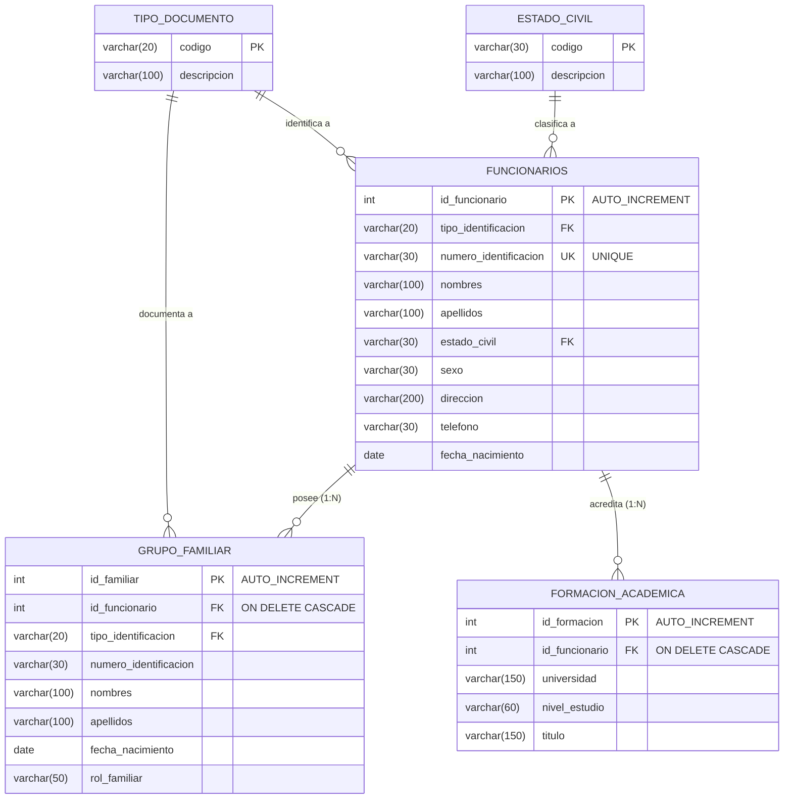

# INSTITUCIÓN UNIVERSITARIA DIGITAL DE ANTIOQUIA
## FACULTAD DE INGENIERÍA Y CIENCIAS APLICADAS
### PROGRAMA ACADÉMICO: TECNOLOGÍA EN DESARROLLO DE SOFTWARE / INGENIERÍA DE SOFTWARE

---

**ASIGNATURA:** Desarrollo de Software Seguro  
**TEMA:** Implementación de Técnicas de Programación Orientada a Objetos utilizando el Patrón DAO y Excepciones en Java  
**ACTIVIDAD:** Caso de Estudio — Gestión de Funcionarios (Recursos Humanos)  

**ESTUDIANTE(S):**  
- [Nombre y Apellidos del Estudiante 1] — Documento: [Número]  
- [Nombre y Apellidos del Estudiante 2] — Documento: [Número] *(Si aplica)*  
- [Nombre y Apellidos del Estudiante 3] — Documento: [Número] *(Si aplica)*  
- [Nombre y Apellidos del Estudiante 4] — Documento: [Número] *(Si aplica)*  

**DOCENTE:**  
[Nombre del Docente Tutor]  

**FECHA DE ENTREGA:**  
Octubre de 2026  
Medellín, Antioquia, Colombia  

---

## 1. INTRODUCCIÓN

En el desarrollo de software moderno y seguro, la separación de responsabilidades y la correcta estructuración del código constituyen pilares indispensables para garantizar la mantenibilidad, escalabilidad y protección de la información. El patrón de diseño **DAO (*Data Access Object*)** desacopla la lógica de negocio de los mecanismos de almacenamiento y persistencia de datos, permitiendo que la aplicación interactúe con el motor de base de datos a través de contratos e interfaces bien definidos.

El presente trabajo aborda el caso de estudio propuesto para el área de recursos humanos de la **Institución Universitaria Digital de Antioquia (IU Digital)**, cuyo objetivo es gestionar de manera centralizada e íntegra los datos personales de los funcionarios que laboran en la entidad, así como sus relaciones asociadas: su grupo familiar (con el rol de cada integrante) y su trayectoria académica (institución, nivel de formación y título obtenido).

A lo largo de este documento se detalla la selección y justificación del motor de base de datos relacional, el diseño formal del modelo entidad-relación y relacional normalizado con las cinco tablas solicitadas, la especificación de los scripts de definición de datos (DDL) y manipulación de datos (DML), así como la construcción de la aplicación de escritorio en Java Swing aplicando Programación Orientada a Objetos, arquitectura en capas, consultas parametrizadas contra inyección SQL (*PreparedStatements*) y un manejo exhaustivo de excepciones técnicas y de negocio.

---

## 2. JUSTIFICACIÓN DEL MOTOR DE BASE DE DATOS

Para el desarrollo de la solución se seleccionó el motor de bases de datos relacional **MySQL / MariaDB** (versión 8.0+ / 10.4+) utilizando el motor de almacenamiento transaccional **InnoDB**.

### Criterios de Selección:
1. **Soporte Transaccional y Claves Foráneas (ACID):** El motor InnoDB ofrece cumplimiento estricto de atomicidad, consistencia, aislamiento y durabilidad, además de integridad referencial nativa mediante restricciones `FOREIGN KEY` con soporte para propagación de acciones en cascada (`ON DELETE CASCADE` y `ON UPDATE CASCADE`).
2. **Seguridad y Prevención de Vulnerabilidades:** Integración con usuarios autenticados, permisos granulares y compatibilidad total con la especificación JDBC mediante `mysql-connector-j`, permitiendo el uso de sentencias preparadas (*PreparedStatements*) que previenen eficazmente ataques de inyección SQL (CWE-89).
3. **Disponibilidad y Rendimiento en Entornos de Desarrollo:** Amplia documentación, facilidad de despliegue mediante entornos como XAMPP, Docker o servicios locales nativos, y herramientas de administración gráfica robustas (MySQL Workbench y phpMyAdmin).

---

## 3. MODELO RELACIONAL DE LA BASE DE DATOS

De acuerdo con los lineamientos de la rúbrica y las necesidades del caso de estudio, se diseñó un modelo relacional en Tercera Forma Normal (3FN) compuesto por **cinco (5) tablas principales**:
1. `tipo_documento`: Catálogo maestro de tipos de documentos de identidad.
2. `estado_civil`: Catálogo maestro de estados civiles.
3. `funcionarios`: Entidad principal que almacena la información personal de cada funcionario.
4. `grupo_familiar`: Entidad débil que representa la composición familiar asociada a un funcionario (Relación 1 a N).
5. `formacion_academica`: Entidad débil que almacena los títulos y estudios alcanzados por cada funcionario (Relación 1 a N).

### 3.1. Diagrama Entidad-Relación y Modelo Relacional (Mermaid)



### 3.2. Diccionario de Datos

| Tabla | Columna | Tipo de Dato | Nulo | Clave | Descripción / Restricción |
|---|---|---|---|---|---|
| **tipo_documento** | codigo | VARCHAR(20) | NO | PK | Código o sigla (CC, TI, CE, Pasaporte, etc.) |
| | descripcion | VARCHAR(100) | NO | | Nombre completo del tipo de documento |
| **estado_civil** | codigo | VARCHAR(30) | NO | PK | Nombre del estado civil (Soltero/a, Casado/a, etc.) |
| | descripcion | VARCHAR(100) | NO | | Descripción del estado civil |
| **funcionarios** | id_funcionario | INT | NO | PK | Identificador interno auto incremental |
| | tipo_identificacion | VARCHAR(20) | NO | FK | Clave foránea a `tipo_documento(codigo)` |
| | numero_identificacion | VARCHAR(30) | NO | UK | Documento de identidad único |
| | nombres | VARCHAR(100) | NO | | Nombres del funcionario |
| | apellidos | VARCHAR(100) | NO | | Apellidos del funcionario |
| | estado_civil | VARCHAR(30) | NO | FK | Clave foránea a `estado_civil(codigo)` |
| | sexo | VARCHAR(30) | NO | | Sexo (Femenino, Masculino, Otro) |
| | direccion | VARCHAR(200) | NO | | Dirección domiciliaria de residencia |
| | telefono | VARCHAR(30) | NO | | Teléfono de contacto |
| | fecha_nacimiento | DATE | NO | | Fecha de nacimiento (no futura) |
| **grupo_familiar** | id_familiar | INT | NO | PK | Identificador auto incremental del familiar |
| | id_funcionario | INT | NO | FK | Clave foránea a `funcionarios` (`ON DELETE CASCADE`) |
| | tipo_identificacion | VARCHAR(20) | SÍ | FK | Clave foránea opcional a `tipo_documento` |
| | numero_identificacion | VARCHAR(30) | SÍ | | Número de documento del familiar |
| | nombres | VARCHAR(100) | NO | | Nombres del miembro familiar |
| | apellidos | VARCHAR(100) | NO | | Apellidos del miembro familiar |
| | fecha_nacimiento | DATE | SÍ | | Fecha de nacimiento del familiar |
| | rol_familiar | VARCHAR(50) | NO | | Parentesco o rol (Hijo/a, Cónyuge, Padre, Madre) |
| **formacion_academica** | id_formacion | INT | NO | PK | Identificador auto incremental del estudio |
| | id_funcionario | INT | NO | FK | Clave foránea a `funcionarios` (`ON DELETE CASCADE`) |
| | universidad | VARCHAR(150) | NO | | Institución universitaria o entidad educativa |
| | nivel_estudio | VARCHAR(60) | NO | | Nivel (Técnico, Tecnología, Profesional, etc.) |
| | titulo | VARCHAR(150) | NO | | Nombre del título o certificado obtenido |

---

## 4. SCRIPTS DE LA BASE DE DATOS

### 4.1. Script DDL de Creación (`sql/01_crear_base_datos.sql`)
El script define el esquema `gestion_funcionarios`, activa el conjunto de caracteres UTF-8 (`utf8mb4`), crea las cinco tablas especificadas y establece las restricciones referenciales con integridad en cascada:

```sql
CREATE DATABASE IF NOT EXISTS gestion_funcionarios
  CHARACTER SET utf8mb4 COLLATE utf8mb4_unicode_ci;
USE gestion_funcionarios;

CREATE TABLE IF NOT EXISTS tipo_documento (
    codigo VARCHAR(20) PRIMARY KEY,
    descripcion VARCHAR(100) NOT NULL
) ENGINE=InnoDB;

CREATE TABLE IF NOT EXISTS estado_civil (
    codigo VARCHAR(30) PRIMARY KEY,
    descripcion VARCHAR(100) NOT NULL
) ENGINE=InnoDB;

CREATE TABLE IF NOT EXISTS funcionarios (
    id_funcionario INT AUTO_INCREMENT PRIMARY KEY,
    tipo_identificacion VARCHAR(20) NOT NULL,
    numero_identificacion VARCHAR(30) NOT NULL UNIQUE,
    nombres VARCHAR(100) NOT NULL,
    apellidos VARCHAR(100) NOT NULL,
    estado_civil VARCHAR(30) NOT NULL,
    sexo VARCHAR(30) NOT NULL,
    direccion VARCHAR(200) NOT NULL,
    telefono VARCHAR(30) NOT NULL,
    fecha_nacimiento DATE NOT NULL,
    CONSTRAINT fk_funcionario_tipo_doc FOREIGN KEY (tipo_identificacion)
      REFERENCES tipo_documento(codigo) ON UPDATE CASCADE,
    CONSTRAINT fk_funcionario_estado_civil FOREIGN KEY (estado_civil)
      REFERENCES estado_civil(codigo) ON UPDATE CASCADE
) ENGINE=InnoDB;

CREATE TABLE IF NOT EXISTS grupo_familiar (
    id_familiar INT AUTO_INCREMENT PRIMARY KEY,
    id_funcionario INT NOT NULL,
    tipo_identificacion VARCHAR(20),
    numero_identificacion VARCHAR(30),
    nombres VARCHAR(100) NOT NULL,
    apellidos VARCHAR(100) NOT NULL,
    fecha_nacimiento DATE,
    rol_familiar VARCHAR(50) NOT NULL,
    CONSTRAINT fk_familiar_funcionario FOREIGN KEY (id_funcionario)
      REFERENCES funcionarios(id_funcionario) ON DELETE CASCADE,
    CONSTRAINT fk_familiar_tipo_doc FOREIGN KEY (tipo_identificacion)
      REFERENCES tipo_documento(codigo) ON UPDATE CASCADE ON DELETE SET NULL
) ENGINE=InnoDB;

CREATE TABLE IF NOT EXISTS formacion_academica (
    id_formacion INT AUTO_INCREMENT PRIMARY KEY,
    id_funcionario INT NOT NULL,
    universidad VARCHAR(150) NOT NULL,
    nivel_estudio VARCHAR(60) NOT NULL,
    titulo VARCHAR(150) NOT NULL,
    CONSTRAINT fk_formacion_funcionario FOREIGN KEY (id_funcionario)
      REFERENCES funcionarios(id_funcionario) ON DELETE CASCADE
) ENGINE=InnoDB;
```

### 4.2. Script DML de Poblado Inicial (`sql/02_datos_iniciales.sql`)
Inserta registros maestros en las tablas `tipo_documento` y `estado_civil`, seguidos de tres funcionarios de prueba con sus correspondientes familiares y estudios académicos:

```sql
USE gestion_funcionarios;

INSERT INTO tipo_documento (codigo, descripcion) VALUES
('CC', 'Cédula de Ciudadanía'),
('TI', 'Tarjeta de Identidad'),
('CE', 'Cédula de Extranjería'),
('RC', 'Registro Civil'),
('Pasaporte', 'Pasaporte Internacional'),
('Otro', 'Otro Documento')
ON DUPLICATE KEY UPDATE descripcion = VALUES(descripcion);

INSERT INTO estado_civil (codigo, descripcion) VALUES
('Soltero/a', 'Persona soltera'),
('Casado/a', 'Persona legalmente casada'),
('Unión libre', 'Unión marital de hecho'),
('Divorciado/a', 'Persona con divorcio legalizado'),
('Viudo/a', 'Persona cuyo cónyuge ha fallecido')
ON DUPLICATE KEY UPDATE descripcion = VALUES(descripcion);

INSERT INTO funcionarios
(tipo_identificacion, numero_identificacion, nombres, apellidos, estado_civil, sexo, direccion, telefono, fecha_nacimiento)
VALUES
('CC', '1001001001', 'Laura Marcela', 'Gómez Ruiz', 'Soltero/a', 'Femenino', 'Calle 10 # 20-30, Medellín', '3001112233', '1995-04-12'),
('CC', '1002002002', 'Andrés Felipe', 'Pérez Soto', 'Casado/a', 'Masculino', 'Carrera 45 # 12-18, Envigado', '3012223344', '1988-09-25'),
('CC', '1003003003', 'Camila Andrea', 'Torres Díaz', 'Unión libre', 'Femenino', 'Vereda El Rosario, Bello', '3023334455', '1992-01-08')
ON DUPLICATE KEY UPDATE nombres = VALUES(nombres);

INSERT INTO grupo_familiar
(id_funcionario, tipo_identificacion, numero_identificacion, nombres, apellidos, fecha_nacimiento, rol_familiar)
VALUES
(1, 'TI', '1100110011', 'Samuel', 'Gómez López', '2018-06-20', 'Hijo/a'),
(2, 'CC', '2200220022', 'María Elena', 'Soto Gil', '1990-02-14', 'Cónyuge');

INSERT INTO formacion_academica (id_funcionario, universidad, nivel_estudio, titulo)
VALUES
(1, 'Universidad de Antioquia', 'Profesional', 'Administración de Empresas'),
(2, 'Politécnico Colombiano Jaime Isaza Cadavid', 'Tecnología', 'Gestión Administrativa'),
(3, 'IU Digital de Antioquia', 'Especialización', 'Gestión del Talento Humano');
```

---

## 5. ARQUITECTURA DE LA APLICACIÓN Y PATRÓN DAO

La solución fue estructurada mediante una **arquitectura por capas desacopladas**:

```
com.iudigital.gestion
├── config/             # Configuración y conexión JDBC (Singleton / Factory)
├── model/              # Clases POJO de entidad (Funcionario, GrupoFamiliar, FormacionAcademica)
├── dao/                # Interfaces y contratos del Patrón DAO
│   └── *Impl.java      # Implementaciones concretas con PreparedStatement
├── service/            # Capa de lógica de negocio y validaciones
├── exception/          # Excepciones personalizadas comprobadas (Checked Exceptions)
└── view/               # Interfaz gráfica de usuario con Java Swing
```

### 5.1. Justificación del Patrón DAO (*Data Access Object*)
El patrón DAO proporciona una interfaz abstracta para interactuar con la base de datos sin exponer los detalles específicos de JDBC ni las sentencias SQL a la interfaz de usuario. Entre sus ventajas directas para esta actividad se destacan:
- **Alta Cohesión y Bajo Acoplamiento:** La capa de presentación (`FuncionarioView`) interactúa exclusivamente con los servicios (`FuncionarioService`), y éstos a su vez con la interfaz DAO (`FuncionarioDAO`). Si se cambia de motor de base de datos a PostgreSQL u Oracle, sólo se sustituye la clase `FuncionarioDAOImpl` sin tocar la interfaz gráfica ni los modelos.
- **Mantenibilidad:** Toda sentencia SQL, mapeo de `ResultSet` y cierre seguro de recursos con `try-with-resources` reside concentrado en la capa DAO.

### 5.2. Capa de Servicios y Reglas de Negocio
Los servicios implementan validaciones defensivas previas al envío de datos a la base de datos:
- `FuncionarioService`:
  - Valida que los campos obligatorios no sean nulos ni vacíos (`nombres`, `apellidos`, `numero_identificacion`, `direccion`, `telefono`, `estado_civil`, `sexo`).
  - Valida que la fecha de nacimiento no sea futura con respecto a la fecha actual (`LocalDate.now()`).
  - Valida que el ID del funcionario sea mayor a cero en operaciones de actualización y eliminación.
- `GrupoFamiliarService`: Valida que exista un funcionario activo seleccionado, nombre y parentesco obligatorios.
- `FormacionAcademicaService`: Valida que exista funcionario seleccionado, nivel de estudio, institución y título.

---

## 6. MANEJO DE EXCEPCIONES Y DESARROLLO DE SOFTWARE SEGURO

En concordancia con los principios de desarrollo de software seguro:
1. **Excepción Personalizada `AccesoDatosException`:**
   Se definió una excepción comprobada (*checked exception*) que extiende de `Exception`. Cuando ocurre un `SQLException` en el acceso a la base de datos, la capa DAO intercepta el error técnico y lanza un `AccesoDatosException` con un mensaje claro y comprensible para el usuario final, preservando la causa original (`cause`) para efectos de auditoría o registro en bitácora.
2. **Traducción de Errores de Integridad Referencial y Claves Únicas:**
   En `FuncionarioDAOImpl`, se analiza el estado SQL devuelto por el motor (`ex.getSQLState()`). Cuando el código es `23000` (violación de restricción de unicidad o clave foránea), el sistema traduce el error técnico a un mensaje amigable:
   `"La identificación ya existe. Ingresa un número diferente."`, evitando fugas de información de la estructura interna de la base de datos (*Information Exposure*).
3. **Cierre Seguro de Recursos:**
   Todas las conexiones, sentencias y conjuntos de resultados se manejan mediante bloques **`try-with-resources`** de Java, garantizando que los objetos `Connection`, `PreparedStatement` y `ResultSet` se cierren de forma inmediata y automática, mitigando fugas de descriptores de conexión (*Resource Exhaustion*).
4. **Prevención de Inyección SQL:**
   No se concatena ninguna entrada de usuario en sentencias SQL. Todas las consultas utilizan parámetros posicionales (`?`) asignados con los métodos tipados de `PreparedStatement` (`setString`, `setInt`, `setDate`).

---

## 7. MANUAL DE USUARIO Y VALIDACIÓN DE SERVICIOS CRUD

La aplicación cuenta con una interfaz organizada mediante un contenedor de pestañas (`JTabbedPane`):

### Pestaña 1: Gestión de Funcionarios (CRUD Principal)
- **Listar:** Al inicializar la aplicación se ejecuta automáticamente `servicioFuncionarios.listar()`, poblando el componente `JTable`.
- **Crear:** Se diligencian los campos en el formulario superior. Al hacer clic en **Crear Funcionario**, el sistema valida campos vacíos y formato de fecha (`AAAA-MM-DD`). Tras confirmar la inserción, limpia el formulario y recarga la tabla.
- **Seleccionar:** Al hacer clic en cualquier fila de la tabla, los datos se transfieren al formulario y el funcionario queda marcado como el **funcionario activo** en todo el sistema.
- **Editar / Actualizar:** Se modifican los campos deseados del funcionario seleccionado y se presiona **Actualizar Funcionario**. El sistema invoca `servicioFuncionarios.actualizar()`.
- **Eliminar:** Con el funcionario seleccionado, se pulsa **Eliminar Funcionario**. El sistema presenta un cuadro de confirmación modal advirtiendo que, debido al borrado en cascada, se eliminarán también sus familiares y estudios asociados.

### Pestaña 2: Grupo Familiar (Relación 1 a N)
- Presenta un indicador superior que muestra el funcionario activo seleccionado.
- Permite registrar parientes vinculados al funcionario seleccionado indicando rol/parentesco, nombres, apellidos, documento y fecha de nacimiento.
- Permite listar, editar y eliminar familiares de forma independiente.

### Pestaña 3: Formación Académica (Relación 1 a N)
- Permite gestionar los estudios del funcionario activo.
- Soporta registrar nivel académico (Técnico, Tecnología, Profesional, Especialización, Maestría, Doctorado), universidad y título obtenido.
- Permite listar, editar y eliminar los estudios cursados.

---

## 8. CONCLUSIONES

1. El uso del **patrón DAO** garantiza una separación limpia entre la lógica de presentación y el acceso a datos, facilitando el mantenimiento, la escalabilidad y las pruebas de la solución.
2. La implementación de **excepciones personalizadas** permite desacoplar los errores específicos del motor de base de datos (`SQLException`) de la capa de presentación, otorgando al usuario mensajes claros de retroalimentación y previniendo la fuga de información sensible.
3. El diseño relacional normalizado con las cinco tablas solicitadas (`funcionarios`, `estado_civil`, `tipo_documento`, `grupo_familiar` y `formacion_academica`) junto con las restricciones de clave foránea e integridad en cascada (`ON DELETE CASCADE`), garantiza la coherencia e integridad de los datos en todo el ciclo de vida de la entidad funcionario.
4. Las prácticas de codificación segura adoptadas (uso de `PreparedStatement`, validaciones previas en la capa de servicio y control de recursos con `try-with-resources`) mitigan las vulnerabilidades más críticas asociadas al manejo de datos en aplicaciones de escritorio empresariales.

---

## 9. REFERENCIAS BIBLIOGRÁFICAS (NORMAS APA 7.ª EDICIÓN)

- Deitel, P. J., & Deitel, H. M. (2018). *Java: Cómo programar* (10.ª ed.). Pearson Educación.
- Fowler, M. (2002). *Patterns of Enterprise Application Architecture*. Addison-Wesley Professional.
- Horstmann, C. S. (2022). *Core Java Volume I: Fundamentals* (12.ª ed.). Prentice Hall.
- Oracle Corporation. (2024). *Trail: JDBC Database Access*. Java Documentation. https://docs.oracle.com/javase/tutorial/jdbc/
- OWASP Foundation. (2021). *OWASP Top Ten: A03:2021 - Injection*. Open Web Application Security Project. https://owasp.org/Top10/A03_2021-Injection/
- Silberschatz, A., Korth, H. F., & Sudarshan, S. (2020). *Database System Concepts* (7.ª ed.). McGraw-Hill.
