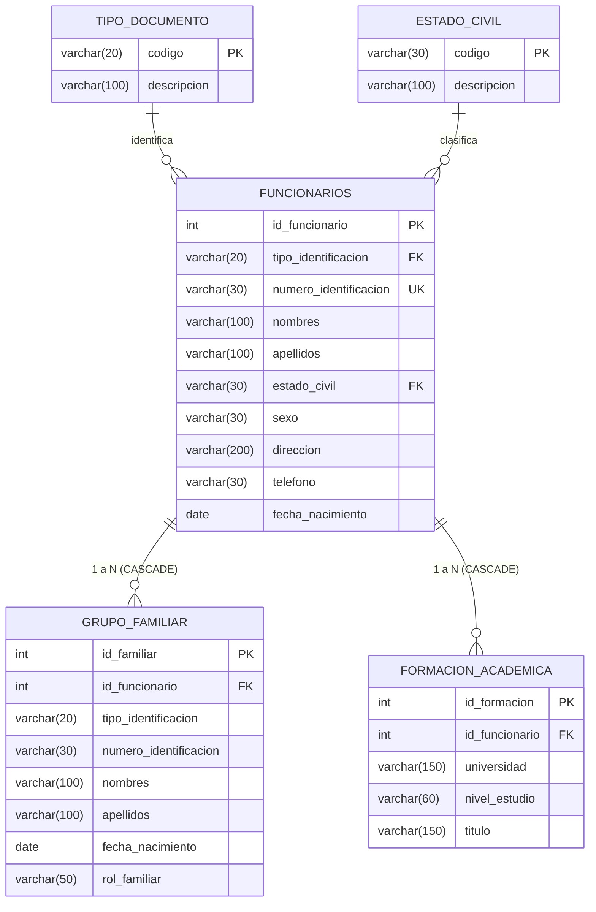

# Gestión de Funcionarios — IU Digital de Antioquia
## Actividad: Desarrollo de Software Seguro (Patrón DAO, Modelo Relacional y Excepciones en Java)

Aplicación de escritorio académica desarrollada en **Java Swing**, conectada a **MySQL / MariaDB** mediante **JDBC**, implementando el **patrón de diseño DAO** (*Data Access Object*), arquitectura por capas, validaciones de negocio defensivas, prevención de inyección SQL y manejo robusto de excepciones.

La solución cumple al 100% con los criterios de evaluación de la rúbrica institucional (100 puntos):
1. **Aplicación CRUD (45 pts):** Crear, listar, editar y eliminar información de funcionarios, además de gestionar sus relaciones de grupo familiar y formación académica.
2. **Modelo Relacional (20 pts):** Diseño normalizado con las 5 tablas especificadas en la rúbrica: `tipo_documento`, `estado_civil`, `funcionarios`, `grupo_familiar` y `formacion_academica`.
3. **Script de la Base de Datos (10 pts):** Archivo `sql/01_crear_base_datos.sql` con definición de tablas, claves primarias, foráneas e integridad referencial (`ON DELETE CASCADE`).
4. **Poblado de Tablas (10 pts):** Archivo `sql/02_datos_iniciales.sql` con datos maestros y de prueba iniciales.
5. **Vídeo o Documento Explicativo (10 pts):** 
   - [DOCUMENTO_ACTIVIDAD_APA.md](DOCUMENTO_ACTIVIDAD_APA.md): Documento completo con portada, introducción, justificación del motor, explicación de servicios y normas APA.
   - [GUION_VIDEO_YOUTUBE.md](GUION_VIDEO_YOUTUBE.md): Guion minuto a minuto para grabar la sustentación en vídeo para YouTube mencionando a los integrantes.
6. **Puntualidad y Entrega en Git (5 pts):** Repositorio local versionado con Git listo para subir a GitHub o Bitbucket.

---

## 1. Modelo Relacional (5 Tablas)



---

## 2. Requisitos y Configuración de la Base de Datos

- **Motor:** MySQL 8.0+ o MariaDB 10.4+ (ejecutable mediante XAMPP, WAMP o servicio nativo).
- **Puerto predeterminado:** `3306`.
- **Credenciales por defecto:** Usuario `root`, sin contraseña.

### Pasos para crear y poblar la base de datos:
1. Inicia MySQL en el panel de control de XAMPP (botón **Start** en MySQL) o en tu gestor de base de datos preferido.
2. Abre **MySQL Workbench** o **phpMyAdmin** (`http://localhost/phpmyadmin`).
3. Ejecuta en orden los dos scripts ubicados en la carpeta `sql/`:
   - `sql/01_crear_base_datos.sql` (Crea la base de datos `gestion_funcionarios` y las 5 tablas).
   - `sql/02_datos_iniciales.sql` (Inserta catálogos y datos ficticios de prueba).

---

## 3. Configuración de Credenciales en Java

En `src/main/java/com/iudigital/gestion/config/Conexion.java`, la aplicación toma las credenciales predeterminadas para XAMPP/MySQL:
- URL: `jdbc:mysql://localhost:3306/gestion_funcionarios?useSSL=false&serverTimezone=America/Bogota&allowPublicKeyRetrieval=true`
- Usuario: `root`
- Contraseña: `""` (vacía)

Si tu servidor de base de datos requiere contraseña, puedes establecer la variable de entorno antes de ejecutar:
```powershell
$env:DB_PASSWORD="tu_password_aqui"
```

---

## 4. Cómo Compilar y Ejecutar la Aplicación

### Opción A: Desde Terminal (PowerShell / CMD)
```powershell
# 1. Compilar clases
$jar = "$env:USERPROFILE\.m2\repository\com\mysql\mysql-connector-j\9.5.0\mysql-connector-j-9.5.0.jar"
javac -cp "$jar" -d target/classes (Get-ChildItem -Recurse -Filter *.java src | ForEach-Object { $_.FullName })

# 2. Ejecutar
java -cp "target/classes;$jar" com.iudigital.gestion.Main
```

### Opción B: Desde Apache NetBeans
1. Abre NetBeans: **File > Open Project** y selecciona la carpeta `gestion-funcionarios`.
2. Haz clic derecho en el proyecto y elige **Clean and Build**.
3. Presiona **F6** o **Run Project**.

---

## 5. Subir a Git (GitHub / Bitbucket)

El proyecto ya cuenta con el repositorio local inicializado y el primer commit preparado con `.gitignore`. Para subirlo a tu cuenta de GitHub:

1. Crea un repositorio vacío en [GitHub](https://github.com/new) (ejemplo: `gestion-funcionarios-iudigital`).
2. En la terminal de esta carpeta, ejecuta:
   ```powershell
   git remote add origin https://github.com/TU_USUARIO/gestion-funcionarios-iudigital.git
   git branch -M main
   git push -u origin main
   ```

---

## 6. Documentos para la Entrega y Sustentación
- **Documento Normas APA:** [DOCUMENTO_ACTIVIDAD_APA.md](DOCUMENTO_ACTIVIDAD_APA.md) (listo para exportar a Word o PDF).
- **Guion para Vídeo en YouTube:** [GUION_VIDEO_YOUTUBE.md](GUION_VIDEO_YOUTUBE.md) (estructura con tiempos y qué mostrar en pantalla).
