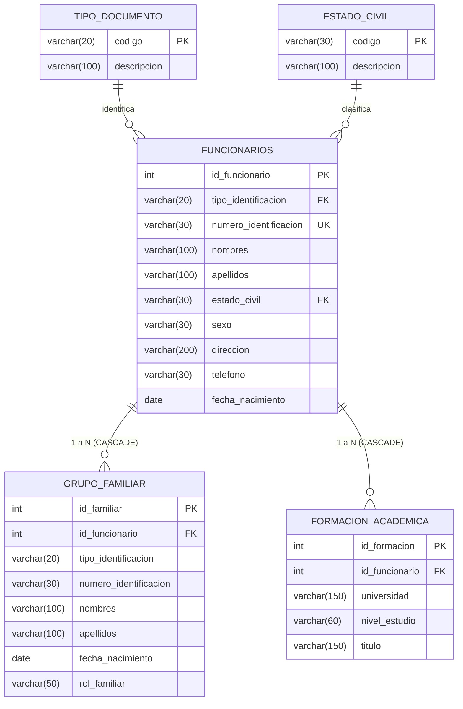

# Gestión de Funcionarios — IU Digital de Antioquia

Aplicación de escritorio desarrollada en **Java Swing** y conectada a **MySQL / MariaDB** mediante **JDBC**, implementando el **patrón de diseño DAO** (*Data Access Object*), arquitectura por capas, validaciones de negocio defensivas, prevención de inyección SQL mediante consultas preparadas (`PreparedStatement`) y manejo de excepciones personalizadas.

---

## Características Principales

- **Gestión Completa de Funcionarios (CRUD):** Registro, consulta detallada, actualización y eliminación de funcionarios.
- **Relaciones Familiares y Académicas:** Administración de grupo familiar y formación académica asociados a cada funcionario con integridad referencial (`ON DELETE CASCADE`).
- **Arquitectura Limpia y Modular:** Separación estricta de responsabilidades en capas (Vista, Servicio/Negocio, DAO, Modelo, Excepciones y Configuración).
- **Seguridad en Acceso a Datos:** Uso exhaustivo de consultas parametrizadas para evitar ataques de inyección SQL y manejo seguro del ciclo de vida de conexiones y recursos JDBC.
- **Interfaz Gráfica Intuitiva:** Vistas construidas en Java Swing con formularios guiados, tablas dinámicas y diálogos de confirmación y alerta.

---

## Arquitectura del Proyecto

```
gestion-funcionarios/
├── documentacion/          # Documentación técnica y diagramas del modelo relacional
│   ├── MODELO_RELACIONAL.md
│   ├── modelo_relacional.drawio
│   ├── modelo_relacional.mmd
│   └── modelo_relacional.png
├── sql/                    # Scripts de inicialización de la base de datos
│   ├── 01_crear_base_datos.sql
│   └── 02_datos_iniciales.sql
├── src/main/java/com/iudigital/gestion/
│   ├── config/             # Conexión a la base de datos (JDBC Singleton / Factory)
│   ├── dao/                # Interfaces e implementaciones del patrón DAO
│   ├── exception/          # Excepciones personalizadas del dominio
│   ├── model/              # Clases de entidad (DTOs / POJOs)
│   ├── service/            # Lógica de negocio y validaciones
│   ├── view/               # Interfaz gráfica de usuario en Swing
│   └── Main.java           # Punto de entrada de la aplicación
└── pom.xml                 # Configuración de dependencias y plugins Maven
```

---

## Modelo Relacional

El sistema implementa 5 tablas normalizadas con claves primarias y foráneas que garantizan la integridad de los datos:



> Para más detalles técnicos y definiciones de campos, consulta [`documentacion/MODELO_RELACIONAL.md`](documentacion/MODELO_RELACIONAL.md).

---

## Requisitos Previos

- **Java JDK:** Versión 17 o 21+.
- **Gestor de Base de Datos:** MySQL 8.0+ o MariaDB 10.4+ (ej. a través de XAMPP, WAMP o Docker).
- **Herramienta de Construcción:** Apache Maven 3.8+ o un IDE compatible (Apache NetBeans, IntelliJ IDEA, Eclipse, VS Code).

---

## Configuración de la Base de Datos

1. Inicia el servicio de MySQL (por ejemplo, desde el panel de **XAMPP**).
2. Abre tu gestor de base de datos preferido (phpMyAdmin, MySQL Workbench, DBeaver o consola).
3. Ejecuta en orden los scripts ubicados en la carpeta `sql/`:
   1. [`sql/01_crear_base_datos.sql`](sql/01_crear_base_datos.sql): Crea la base de datos `gestion_funcionarios` y las tablas con sus relaciones.
   2. [`sql/02_datos_iniciales.sql`](sql/02_datos_iniciales.sql): Inserta los catálogos base (`tipo_documento`, `estado_civil`) y registros de prueba.

### Parámetros de Conexión
La clase `Conexion.java` (`src/main/java/com/iudigital/gestion/config/Conexion.java`) utiliza por defecto:
- **Host / Puerto:** `localhost:3306`
- **Base de Datos:** `gestion_funcionarios`
- **Usuario:** `root`
- **Contraseña:** `""` *(vacía por defecto para XAMPP)*

Si tu motor requiere contraseña o parámetros diferentes, puedes establecer la variable de entorno:
```powershell
$env:DB_PASSWORD="tu_password"
```

---

## Compilación y Ejecución

### Opción 1: Con Apache Maven (Recomendada)

Desde la terminal en la raíz del proyecto (`gestion-funcionarios`):

```powershell
# Compilar el proyecto
mvn clean compile

# Ejecutar la aplicación
mvn exec:java
```

### Opción 2: Desde Apache NetBeans

1. Ve a **File > Open Project** y selecciona la carpeta del proyecto.
2. Haz clic derecho sobre el proyecto y selecciona **Clean and Build**.
3. Presiona **F6** o haz clic en **Run Project**.

---

## Control de Versiones

Repositorio oficial en GitHub:
[https://github.com/alexaggira-creator/gestion-funcionarios.git](https://github.com/alexaggira-creator/gestion-funcionarios.git)
