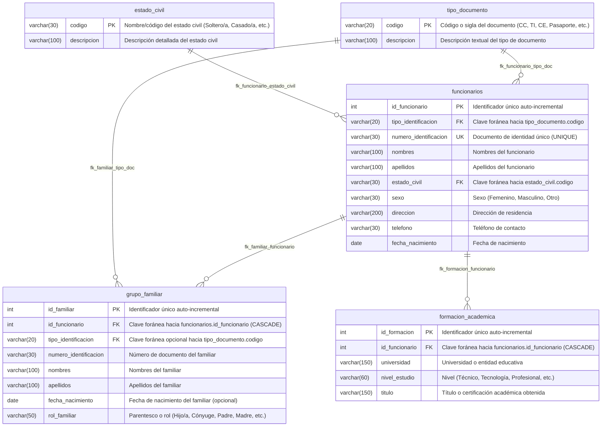

# MODELO RELACIONAL DE LA BASE DE DATOS
## Sistema de Gestión de Funcionarios — IU Digital de Antioquia

Este documento describe formalmente el modelo relacional diseñado e implementado en el script `sql/01_crear_base_datos.sql`, verificado con el poblado inicial en `sql/02_datos_iniciales.sql`.

---

## 1. Diagrama Relacional (Formato Mermaid)

---

## 2. Diccionario de Datos Oficial (5 Tablas)

### 2.1. Tabla: `tipo_documento`
Catálogo maestro para normalizar los tipos de documento de identidad permitidos en la institución.
- **Motor:** InnoDB
- **Charset:** utf8mb4 / utf8mb4_unicode_ci

| Columna | Tipo de Dato | Nulo | Clave | Valor por Defecto | Descripción |
|---|---|---|---|---|---|
| `codigo` | `VARCHAR(20)` | **NO** | **PK** | Ninguno | Código/sigla del documento (ej. 'CC', 'TI', 'CE', 'Pasaporte'). |
| `descripcion` | `VARCHAR(100)` | **NO** | | Ninguno | Nombre formal y descripción del tipo de documento. |

---

### 2.2. Tabla: `estado_civil`
Catálogo maestro para normalizar el estado civil de los funcionarios.
- **Motor:** InnoDB
- **Charset:** utf8mb4 / utf8mb4_unicode_ci

| Columna | Tipo de Dato | Nulo | Clave | Valor por Defecto | Descripción |
|---|---|---|---|---|---|
| `codigo` | `VARCHAR(30)` | **NO** | **PK** | Ninguno | Código/nombre del estado civil (ej. 'Soltero/a', 'Casado/a'). |
| `descripcion` | `VARCHAR(100)` | **NO** | | Ninguno | Descripción del estado civil. |

---

### 2.3. Tabla: `funcionarios`
Entidad principal del sistema que almacena los datos personales de cada funcionario.
- **Motor:** InnoDB
- **Charset:** utf8mb4 / utf8mb4_unicode_ci

| Columna | Tipo de Dato | Nulo | Clave | Valor por Defecto | Descripción |
|---|---|---|---|---|---|
| `id_funcionario` | `INT` | **NO** | **PK** | `AUTO_INCREMENT` | Identificador único interno generado por la base de datos. |
| `tipo_identificacion` | `VARCHAR(20)` | **NO** | **FK** | Ninguno | Tipo de documento, referencia a `tipo_documento(codigo)`. |
| `numero_identificacion` | `VARCHAR(30)` | **NO** | **UK** | Ninguno | Número de identificación único. No permite duplicados. |
| `nombres` | `VARCHAR(100)` | **NO** | | Ninguno | Nombres completos del funcionario. |
| `apellidos` | `VARCHAR(100)` | **NO** | | Ninguno | Apellidos completos del funcionario. |
| `estado_civil` | `VARCHAR(30)` | **NO** | **FK** | Ninguno | Estado civil, referencia a `estado_civil(codigo)`. |
| `sexo` | `VARCHAR(30)` | **NO** | | Ninguno | Género/sexo del funcionario. |
| `direccion` | `VARCHAR(200)` | **NO** | | Ninguno | Dirección domiciliaria de residencia. |
| `telefono` | `VARCHAR(30)` | **NO** | | Ninguno | Número telefónico de contacto personal. |
| `fecha_nacimiento` | `DATE` | **NO** | | Ninguno | Fecha de nacimiento (validada no futura). |

---

### 2.4. Tabla: `grupo_familiar`
Almacena los integrantes del grupo familiar vinculados a un funcionario (relación 1 a N).
- **Motor:** InnoDB
- **Charset:** utf8mb4 / utf8mb4_unicode_ci

| Columna | Tipo de Dato | Nulo | Clave | Valor por Defecto | Descripción |
|---|---|---|---|---|---|
| `id_familiar` | `INT` | **NO** | **PK** | `AUTO_INCREMENT` | Identificador único del integrante familiar. |
| `id_funcionario` | `INT` | **NO** | **FK** | Ninguno | Clave foránea al funcionario (`ON DELETE CASCADE`). |
| `tipo_identificacion` | `VARCHAR(20)` | **SÍ** | **FK** | `NULL` | Tipo de documento del familiar (`ON DELETE SET NULL`). |
| `numero_identificacion` | `VARCHAR(30)` | **SÍ** | | `NULL` | Número de documento del familiar. |
| `nombres` | `VARCHAR(100)` | **NO** | | Ninguno | Nombres del familiar. |
| `apellidos` | `VARCHAR(100)` | **NO** | | Ninguno | Apellidos del familiar. |
| `fecha_nacimiento` | `DATE` | **SÍ** | | `NULL` | Fecha de nacimiento opcional del familiar. |
| `rol_familiar` | `VARCHAR(50)` | **NO** | | Ninguno | Rol o parentesco (Hijo/a, Cónyuge, Padre, Madre, etc.). |

---

### 2.5. Tabla: `formacion_academica`
Almacena el historial y títulos académicos vinculados a un funcionario (relación 1 a N).
- **Motor:** InnoDB
- **Charset:** utf8mb4 / utf8mb4_unicode_ci

| Columna | Tipo de Dato | Nulo | Clave | Valor por Defecto | Descripción |
|---|---|---|---|---|---|
| `id_formacion` | `INT` | **NO** | **PK** | `AUTO_INCREMENT` | Identificador único del registro de estudio. |
| `id_funcionario` | `INT` | **NO** | **FK** | Ninguno | Clave foránea al funcionario (`ON DELETE CASCADE`). |
| `universidad` | `VARCHAR(150)` | **NO** | | Ninguno | Institución universitaria o entidad educativa. |
| `nivel_estudio` | `VARCHAR(60)` | **NO** | | Ninguno | Nivel cursado (Técnico, Tecnología, Profesional, etc.). |
| `titulo` | `VARCHAR(150)` | **NO** | | Ninguno | Título o certificado obtenido. |

---

## 3. Matriz de Integridad Referencial y Claves Foráneas (FK)

| Nombre del Constraint | Tabla Origen | Columna Origen | Tabla Destino | Columna Destino | Regla ON UPDATE | Regla ON DELETE |
|---|---|---|---|---|---|---|
| `fk_funcionario_tipo_doc` | `funcionarios` | `tipo_identificacion` | `tipo_documento` | `codigo` | `CASCADE` | `RESTRICT` |
| `fk_funcionario_estado_civil` | `funcionarios` | `estado_civil` | `estado_civil` | `codigo` | `CASCADE` | `RESTRICT` |
| `fk_familiar_funcionario` | `grupo_familiar` | `id_funcionario` | `funcionarios` | `id_funcionario` | `CASCADE` | `CASCADE` |
| `fk_familiar_tipo_doc` | `grupo_familiar` | `tipo_identificacion` | `tipo_documento` | `codigo` | `CASCADE` | `SET NULL` |
| `fk_formacion_funcionario` | `formacion_academica` | `id_funcionario` | `funcionarios` | `id_funcionario` | `CASCADE` | `CASCADE` |

---

## 4. Archivos Entregables del Diagrama

Dentro de esta carpeta `documentacion/` se encuentran disponibles los siguientes formatos:

1. **`modelo_relacional.png`:**
   - Imagen en alta resolución (1450 x 920 px) lista para insertar en el documento Word/PDF de entrega o diapositivas.
2. **`modelo_relacional.drawio`:**
   - Archivo editable compatible con [diagrams.net](https://app.diagrams.net/) (anteriormente draw.io).
3. **`modelo_relacional.mmd`:**
   - Código fuente Mermaid para plataformas que soportan renderizado directo (GitHub, GitLab, Obsidian, etc.).
